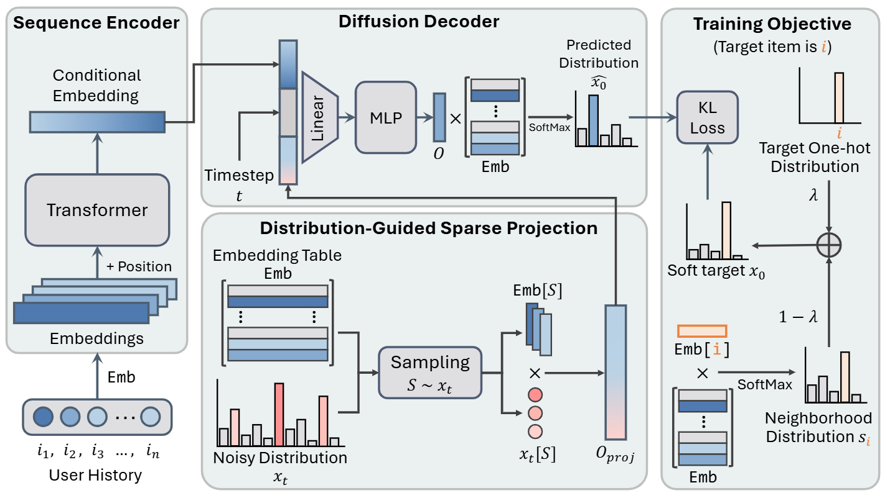

# PreDiff

This is the official implementation for our paper ["PreDiff: Sequential Recommendation by Denoising Preference Distributions"](https://openreview.net/pdf?id=pzpHoCx0Yr). PreDiff is a distribution-space diffusion model for sequential recommendation that denoises item preference distributions rather than item embeddings. Its central idea is to better preserve the fine-grained ranking signals that embedding-space noise can erase early. The key innovations are:
- **Ranking-preserving diffusion**. Add independent noise to each item's preference score, avoiding the additional ranking degradation caused by similarities between item embeddings (Theorem 1 in the paper).
- **Distribution-Guided Sparse Projection**. Sample items according to the noisy preference distribution and aggregate their embeddings, recovering semantic relationships while filtering out low-relevance noise.
- **Similarity-based soft targets**. Combines the observed next item with information about similar items, providing richer supervision for learning rankings within the relevant item neighborhood.


<div align="center">
  
  <p><em>PreDiff Architecture.</em></p>
</div>


## 🛠️ Setup

You can set up the environment and install dependencies as follows:

```bash
conda create -n prediff python=3.9 -y
conda activate prediff
# install torch with your desired CUDA version
pip install torch==2.0.1+cu118 --extra-index-url https://download.pytorch.org/whl/cu118
pip install -r requirements.txt
```

### Data Preparation

Download and prepare the datasets by running the following commands:

```bash
cd data && bash download.sh beauty toys ml1m ml25m && cd ..
```

This downloads raw data from official sources and preprocesses them into `.pickle` files required for training and evaluation.


## 🚀 Run Evaluation

### Model Training

You can start the training process for the specified dataset on the specified GPU by running the following command:

```bash
python run.py --dataset <dataset_name> --gpu <gpu_id>

# For example, training on the Amazon Beauty dataset with GPU 0:
python run.py --dataset beauty --gpu 0
```

The training results and logs will be saved in the `results/` directory by default.

### Model Inference

The command below runs inference and evaluation on the specified dataset using the provided checkpoint:

```bash
python eval_test.py --dataset <dataset_name> --gpu <gpu_id> --ckpt <checkpoint_path>

# For example, evaluating the trained model on the Amazon Beauty dataset with GPU 0:
python eval_test.py --dataset beauty --gpu 0 --ckpt results/beauty-YYYYMMDD-HHMMSS/prediff_beauty_best.pt
```

For convenience, we also provide trained model checkpoints for all four datasets in the [checkpoints](/checkpoints) directory. Test-set results for these checkpoints are shown below (%). 

| Dataset | Hit@10 | Hit@20 | NDCG@10 | NDCG@20 |
| --- | ---: | ---: | ---: | ---: |
| Amazon Beauty | 9.55 | 13.09 | 5.67 | 6.56 |
| Amazon Toys | 10.25 | 13.43 | 6.42 | 7.22 |
| MovieLens-1M | 34.78 | 46.03 | 20.29 | 23.12 |
| MovieLens-25M | 24.43 | 33.47 | 14.19 | 16.47 |


## 📘 Acknowledgements

If you find this work useful, please consider citing our paper:

```bibtex
@inproceedings{
chen2026prediff,
title={PreDiff: Sequential Recommendation by Denoising Preference Distributions},
author={Yaoqi Chen and Jianjin Zhang and Qi Chen and Weihao Han and Yujing Wang and Hao Sun},
booktitle={The Fortieth Annual Conference on Neural Information Processing Systems},
year={2026},
url={https://openreview.net/forum?id=pzpHoCx0Yr}
}
```